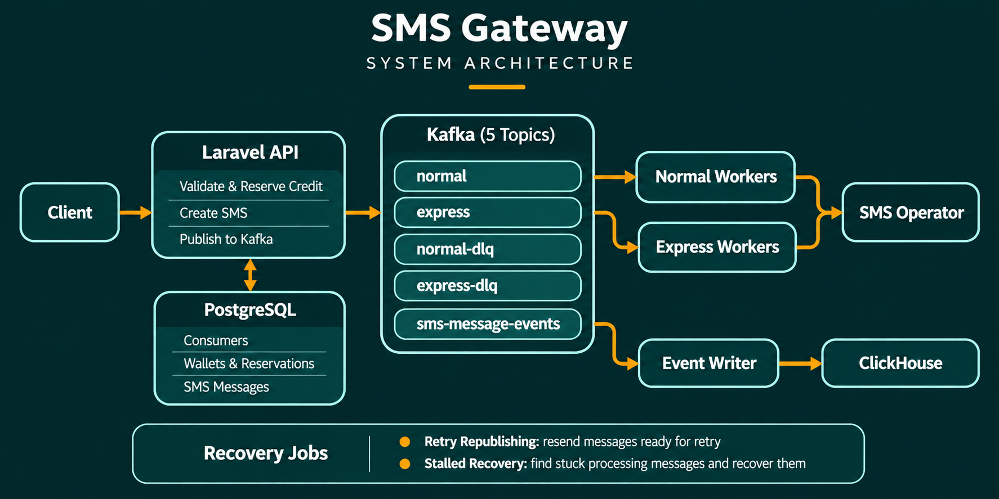
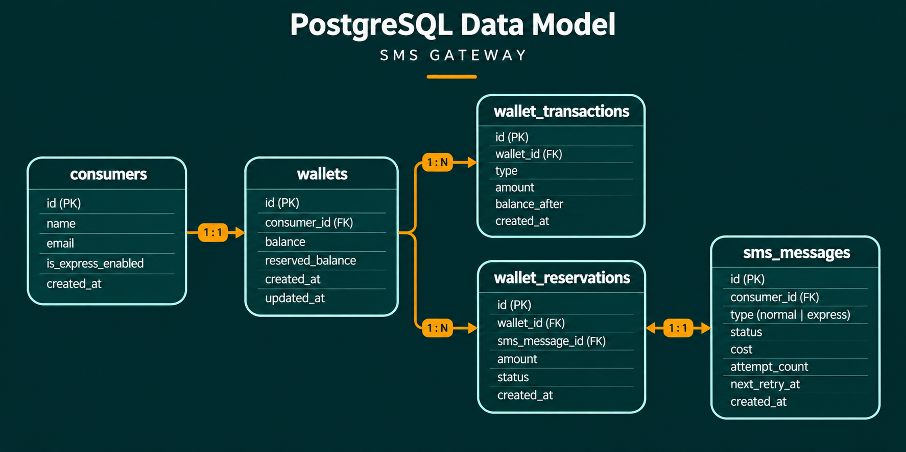

# SMS Gateway

A Laravel-based prepaid SMS Gateway designed for high-volume SMS traffic using an **asynchronous**, **event-driven architecture**. It supports separate Normal and Express delivery pipelines, wallet-based billing, automatic retries, and searchable message-event history.

## Features

- **Normal & Express SMS Manager:** Isolated Kafka topics, consumer groups, and worker pools.
- **Wallet Manager:** Credit top-ups, atomic balance reservations, transaction history, and automatic reservation settlement.
- **Asynchronous Processing:** API requests return `202 Accepted` without waiting for the SMS operator.
- **Retry Mechanism:** Exponential backoff for transient operator failures.
- **Dead-Letter Queues:** Separate DLQ topics for Normal and Express messages.
- **Event History:** Asynchronous event loging into ClickHouse with kafka.
- **Recovery Jobs:** Scheduled retry republishing.

## Data Model

| Table                 | Purpose                                             |
| --------------------- | --------------------------------------------------- |
| `consumers`           | user entity                                         |
| `wallets`             | Wallet balance and reserved balance                 |
| `wallet_reservations` | Credit holds associated with SMS messages           |
| `wallet_transactions` | Credit/debit ledger and resulting balance           |
| `sms_messages`        | SMS content, type, cost, status, and retry metadata |

### ClickHouse

`sms_message_events` table:

- Message and consumer identifiers
- Event type and SMS status
- Recipient and message metadata
- Attempt count and retry timestamp
- Error details and HTTP status
- Event timestamp and contextual metadata

Events are consumed from Kafka and inserted into ClickHouse in batches.

## Message Processing

1. The API validates the request and checks the consumer's eligibility and available credits.
2. PostgreSQL stores the SMS and reserves the required credits.
3. The job is published to the appropriate Kafka topic.
4. The API returns `202 Accepted`.
5. A dedicated worker consumes the message and calls the SMS operator.
6. On operator acceptance, the reservation is confirmed and the wallet is debited.
7. Transient failures are retried with exponential backoff.
8. Permanent failures, exhausted retries, or expired reservations lead to failure handling and credit release.
9. Lifecycle events are published asynchronously and stored in ClickHouse by a separate writer.

## Kafka Topics

| Topic                | Purpose                                            |
| -------------------- | -------------------------------------------------- |
| `normal`             | Normal SMS jobs                                    |
| `express`            | Express SMS jobs                                   |
| `normal-dlq`         | Normal messages routed to the dead-letter queue    |
| `express-dlq`        | Express messages routed to the dead-letter queue   |
| `sms-message-events` | Lifecycle events consumed by the ClickHouse writer |

## APP Directory

- **Actions:** Application use cases and business rules.
- **Contracts:** Interfaces for queue and event-log integrations.
- **Services:** Kafka, ClickHouse, and SMS operator adapters.
- **Models & Enums:** Domain entities and state definitions.
- **Console Commands:** Kafka consumers, event writer, retry republisher, and stalled-message recovery.
- **Migrations & Factories:** Database schema and test-data generation.

|     |
| --- |
